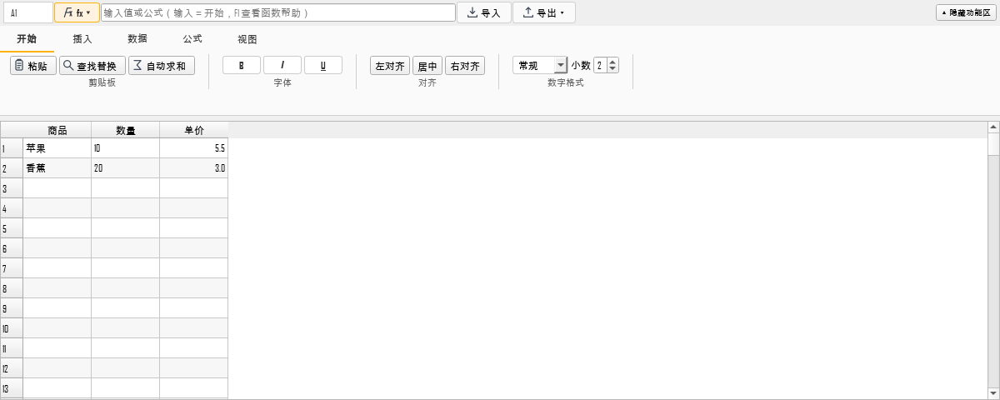
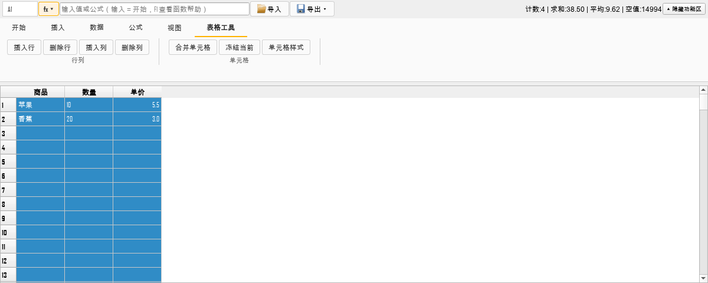
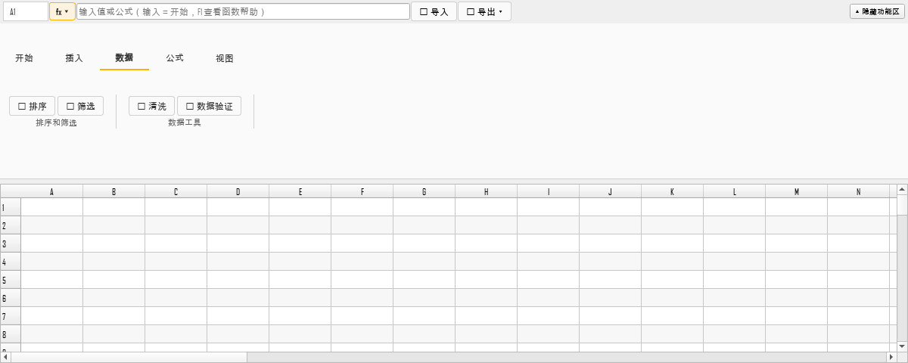
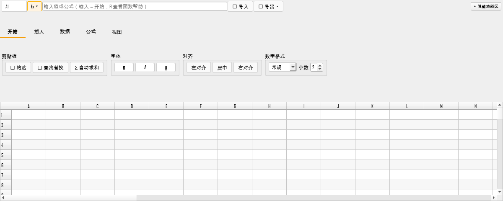
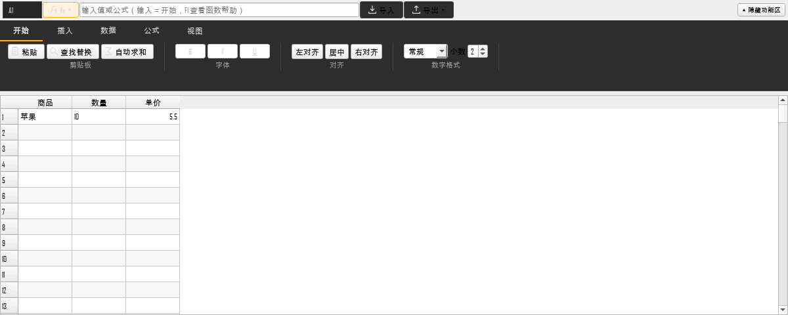
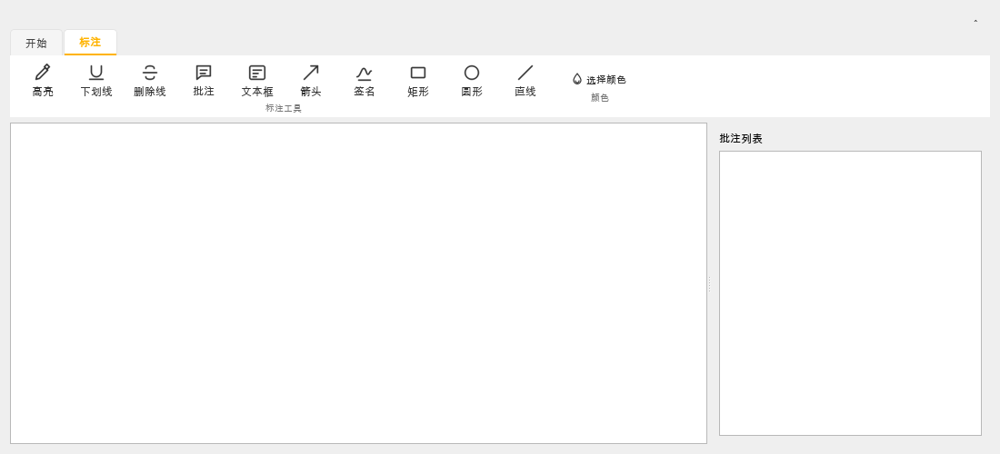
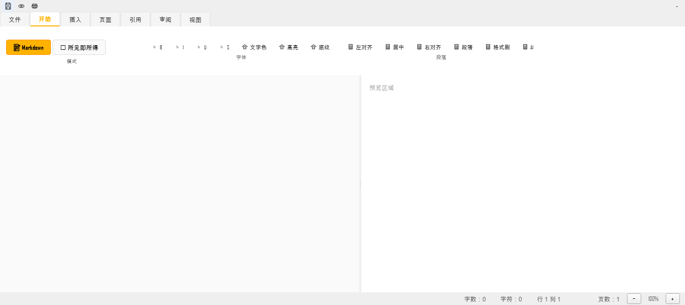
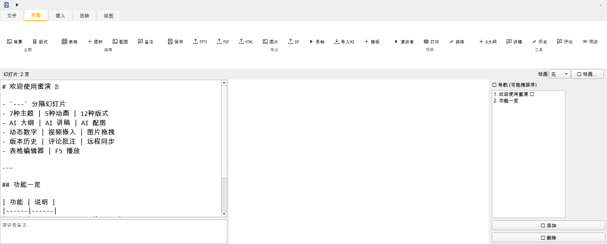
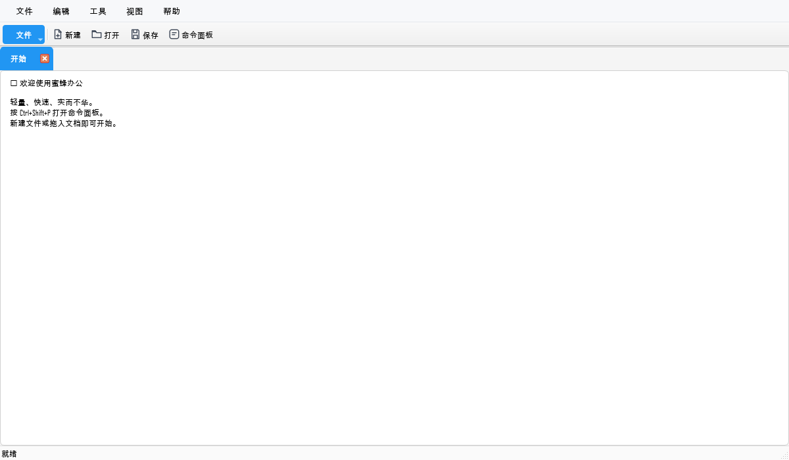

# BeeSheet 分类功能区（WPS 风格 Ribbon）

日期：2026-11-13  
版本：v5.4.7（未发布）

## 变更

原 BeeSheet 顶部是 4 行散乱按钮，功能没有清晰归属。现改为 WPS 风格分类功能区：

```text
开始 | 插入 | 数据 | 公式 | 视图
```

每页内部再按功能分组：

| 分类 | 分组 |
|---|---|
| 开始 | 剪贴板、字体、对齐、数字格式 |
| 插入 | 对象（图表/透视表/批注）、数据工具（智能填充） |
| 数据 | 排序和筛选、数据工具（清洗/数据验证） |
| 公式 | 函数（fx/函数参考）、名称与审计（名称管理/追踪/自然语言） |
| 视图 | 冻结窗格、显示（样式/兼容性/统计） |

顶部始终保留：名称框、fx、公式栏、导入、导出、加载进度、状态、隐藏功能区。

## 初始网格

- 行数：5000（原 1000）
- 列数：52（A–AZ，原 10）
- 默认列宽 82px，默认行高 24px，可视列数接近 WPS；
- 空表仍按需显示，不把空行写入数据。

## 截图



表格工具上下文页签（选中多个单元格时出现）：



数据页示例：



初始网格（A–AZ，5000 行）：



## UI 细化

- 去掉 emoji，导入/导出使用 Qt 标准图标，其余按钮统一文本；
- 选中多个单元格时自动显示“表格工具”上下文页签；
- 记住上次打开的页签（QSettings）；
- 窗口宽度 <980px 时隐藏组标题，进入紧凑模式；
- 主窗口 QMenuBar 改为 WPS 风格扁平样式。

- 组名改为底部小字（WPS 风格），去掉重边框；
- 组之间加细竖线分隔；
- Tab 选中使用主题 accent 下划线；
- 按钮 hover/pressed/checked 统一主题样式；
- 功能区背景使用 surface_alt，与表格区分层。

## 图标主题

- 图标默认读取 Theme.tokens()["text"]；
- `apply_theme` 时重建图标，亮色深色自动换色；
- BeeWrite/BeeShow 原有 Ribbon 也复用同一套 SVG 图标工厂。



## PDF 模块 WPS 化



- BeeWrite：已有 WPS Ribbon（文件/开始/插入/页面/引用/审阅/视图）
- BeeShow：已有 WPS Ribbon（文件/开始/插入/放映/视图）
- BeePDF：本次改为 开始/标注 两页 Ribbon

## 边框/底纹图库

表格工具页签新增“边框/底纹”：

- 底纹：琥珀/浅黄/浅绿/浅蓝/浅粉/浅灰/深蓝/橙色；
- 外边框：细黑/中黑/细蓝/细橙/粗橙；
- 单边框：上/下/左/右独立设置；
- 支持清除；
- 单元格背景与边框由 model/delegate 实际绘制。

## 打印/分享/自定义

- 主窗口快捷栏新增“打印”“分享”；
- 打印调用当前页面的 `_print_preview`，不支持时提示；
- 分享将当前文件路径复制到剪贴板；
- ⚙ 菜单可勾选/取消快捷按钮，QSettings 记忆；
“调整顺序…”支持拖拽排序并持久化。

## BeeWrite / BeeShow Ribbon

BeeWrite 开始页：模式 / 字体 / 段落。



BeeShow 开始页：主题 / 编辑 / 导出 / 放映 / 工具。



## 主窗口 WPS 入口



- 左侧“文件”入口（弹出新建/打开/保存/命令面板）；
- 右侧快捷工具栏：新建、打开、保存、命令面板；
- QMenuBar 改为 WPS 扁平样式。

## 兼容性

- `_toggle_toolbars(btn)` 保留，改为隐藏/展开整个 Ribbon；
- 原有按钮/格式控件属性保留（`_fmt_bold_btn`、`_num_format_combo`、`_stat_btn` 等）；
- 清理旧的无引用翻译键 8 个，`test_i18n_unused_keys.py` 通过。

## 测试

```text
tests/qt/test_beesheet_ribbon.py  4 passed
相关 GUI/i18n 测试通过
```
