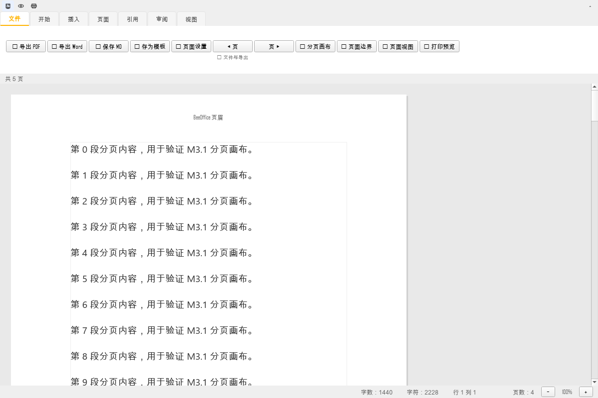
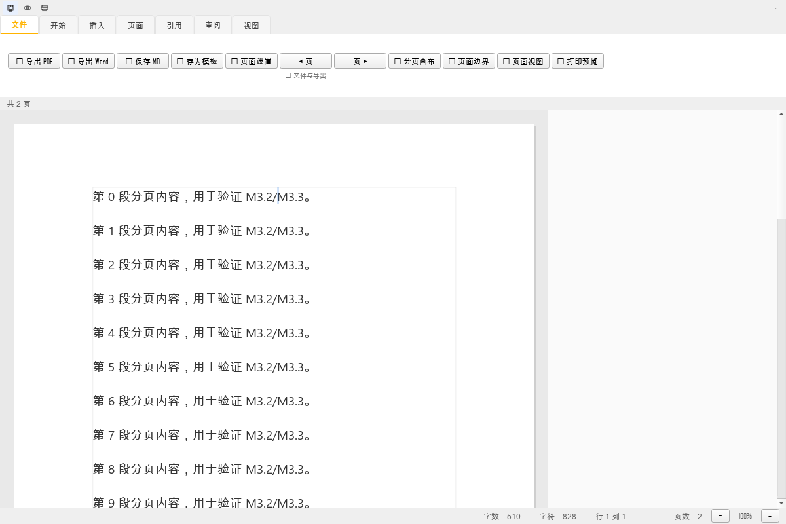
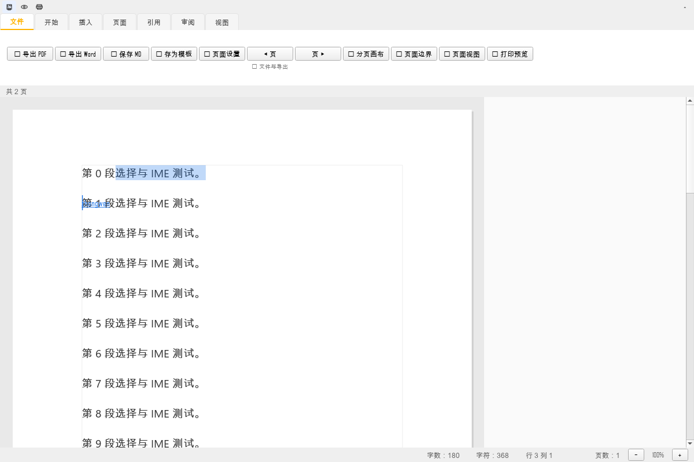
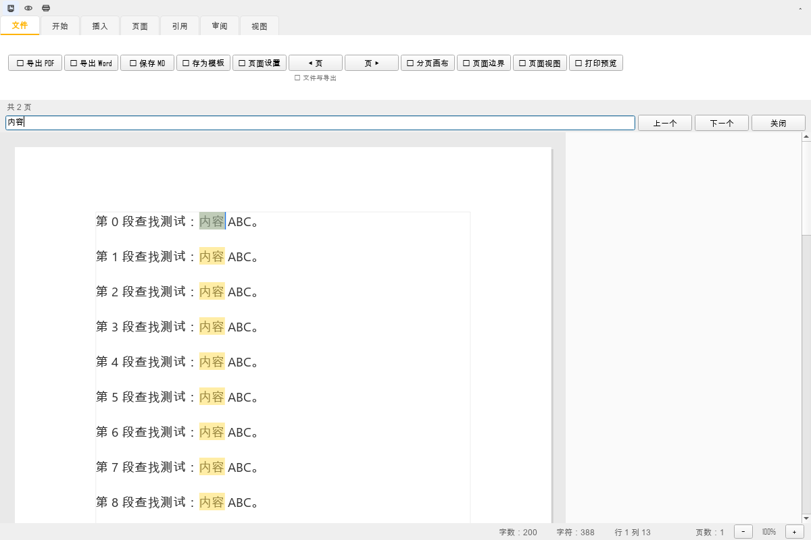

# M2.7 与 M3 分页编辑技术方案（2026-11-09）

## 1. M2.7 已完成

- 页面边界参考层（M2.5）；
- 页边距缩进与页眉页脚避让（M2.6）；
- **按页滚动**：
  - 快速栏“◀ 页 / 页 ▶”；
  - `Ctrl+PageUp` / `Ctrl+PageDown`；
  - 按页面高度估算页数并跳转；
- 单页编辑范围选择、撤销保留、跨页对象告警（M2）。

仍缺少：
- 真实页间空白间距；
- 页眉页脚随页切换；
- 文字在页边界真实断页。

## 2. M3 关键技术结论

实验：`QTextEdit` 设置 `document().setPageSize(300x200)` 后：

```text
pageCount = 1
scrollMax = 360
docSize = 384x658
```

结论：**QTextEdit 不会按 pageSize 分页显示**，仍按自身宽度连续布局。  
因此不能通过“打开 pageSize”得到 WPS 式分页编辑。

## 3. M3 可选架构

### A. 自绘 QTextDocument 分页画布（推荐基础）
- 用 `QTextDocument.setTextWidth(content_w)` + `setPageSize(content_h)`；
- `QAbstractTextDocumentLayout.draw()` 逐页绘制；
- 页面间隙、页眉页脚、页码由画布绘制；
- 编辑层需要自己处理光标/选择/输入法。

### B. 每页一个 QTextEdit
- 页内编辑直接用 Qt 原生控件；
- 跨页同步、撤销栈、表格/图片跨页复杂；
- 风险高。

### C. 隐藏 RichTextEditor 作为模型 + 自绘分页视图
- 保留现有编辑器作为数据/格式化模型；
- 自绘分页画布只负责显示；
- 鼠标点击映射到 QTextCursor；
- 键盘/输入法转发给隐藏编辑器；
- 可逐步替换，风险最低，推荐作为 M3 实现路线。

## 4. M3 里程碑

| 阶段 | 内容 | 预估 |
|---|---|---:|
| M3.1 | 只读分页画布：真实页数/页间间距/页眉页脚 | 3 PD |
| M3.2 | 点击定位 + 光标绘制 | 2 PD |
| M3.3 | 键盘输入/删除/选择 | 4 PD |
| M3.4 | 撤销/重做、查找、格式化联动 | 4 PD |
| M3.5 | 表格/图片跨页、打印一致性 | 4 PD |
| M3.6 | 回归与性能 | 3 PD |

合计约 **20 PD**，按 2 开发约 2–3 周；不做降级方案。

## 5. 下一步

先实现 M3.1 只读分页画布作为技术验证：
- 用同一 `QTextDocument` 渲染；
- 页面之间真实空隙；
- 页眉页脚/页码；
- 单元测试验证页数、页面矩形、无内容丢失。


## 6. M3.1 已完成（2026-11-09）

- 新增 `PagedCanvas`：只读分页画布；
- 用 `QTextDocument` 克隆按 A4 页大小真实分页；
- 页面之间真实空隙；
- 页眉/页脚/页码；
- 快速栏“📄 分页画布”切换；
- 点击页面返回主编辑区并定位到对应字符位置。

截图：



测试：
- 5 页分页正常；
- 点击位置 3 返回编辑器并定位成功。

## 7. M3.2 状态

- 点击定位：✅ 已完成；
- 画布内光标绘制：❌ 未完成；
- 键盘直接输入/选择：❌ 未完成（M3.3）。

下一步 M3.3：
- 在分页画布上显示光标；
- 键盘输入/删除/选择映射到文档；
- 再替换主编辑区。


## 8. M3.2 / M3.3 进度（2026-11-09）

### M3.2 光标绘制

- 分页画布显示蓝色光标；
- 点击页面设置光标位置；
- 光标闪烁；
- 可编辑模式下点击不退出画布。

### M3.3 键盘编辑（基础版）

已支持：
- 插入文字；
- 回车换行；
- Backspace / Delete；
- 方向键 / Home / End；
- Ctrl+V 粘贴；
- Ctrl+Z / Ctrl+Y。

验证：
- 在 `abcdef` 中光标定位 3，输入 `X` → `abcXdef`；
- Backspace 删除后恢复 `abcdef`；
- 光标位置在画布中可见。

截图：



### 仍未完成

- Shift+方向键选择；
- 鼠标拖选；
- 输入法（中文 IME）组合输入；
- 富文本格式/表格内编辑；
- 撤销光标位置恢复。

下一步：
1. 选择/拖选；
2. IME；
3. 格式化联动；
4. 替换主编辑区。


## 9. M3.2 / M3.3 增补（2026-11-09）

新增：
- Shift+方向键选择；
- 鼠标拖选（画布事件过滤器）；
- Ctrl+A / Ctrl+C / Ctrl+X；
- 输入法提交（commit）与预编辑（preedit）显示；
- 格式化工具栏联动：画布选择同步到隐藏的富文本编辑器，粗体等格式应用后回写文档；
- Ctrl+F：从画布切回富文本编辑区打开查找栏（画布内高亮尚未实现）。

截图：



测试：
- Shift+Right 选择 0–1、0–2；
- Ctrl+C 复制 "ab"，并同步富文本光标选择；
- `_set_cursor` 扩展选择 1–4；
- IME 提交“中文”成功；
- 画布选择 0–3 后 `_toggle_bold()`，文档字符格式变为粗体；
- 全量测试 **1020 passed**。

仍未完成：
- 画布内查找高亮；
- IME 预编辑的精确定位/候选框跟随；
- 表格/图片对象内的选择与编辑；
- 大文档每次编辑重建画布的性策略。


## 10. 画布内查找与性能优化（2026-11-09）

### 画布内查找

- Ctrl+F 在画布内打开查找栏（不再跳回富文本编辑区）；
- 输入即高亮全部匹配（上限 500 个）；
- “上一个 / 下一个”跳转并滚动到匹配位置；
- Esc 关闭；
- 当前匹配用选择颜色高亮。

截图：



### 性能优化

1. 编辑后不再立刻克隆整篇文档，改为 **35ms 防抖重建**；
2. 只在选择真正变化时同步富文本编辑器光标，减少每次按键的布局重算。

实测（300 段落、100 次按键）：

| 版本 | 100 次编辑耗时 |
|---|---:|
| 优化前 | 6.907s |
| 优化后 | 4.085s |
| 单次按键 | 约 41ms |

仍不理想。下一步：
- 用增量布局/只重绘受影响页；
- 编辑时保留旧页图，空闲时重建；
- 大文档分页缓存。


## 11. 增量布局 + 主编辑区切换（2026-11-09）

### 增量布局

- 分页画布不再每次编辑克隆整篇文档；
- 直接使用主文档作为分页文档；
- 编辑后只调用 `PaperPageView.recalc()` 重算页数/尺寸；
- 35ms 防抖，空闲时重排。

实测（300 段落、100 次按键）：

| 版本 | 100 次编辑耗时 | 单次 |
|---|---:|---:|
| 克隆整篇 | 6.907s | 69ms |
| 防抖克隆 | 4.085s | 41ms |
| 直接文档 + 增量 recalc | **2.461s** | **约 25ms** |

### 主编辑区切换

- Word 文档新建/打开后默认进入分页画布；
- “📄 分页画布”按钮可切回连续编辑；
- Markdown 文档保持连续编辑。

### 表格/图片跨页对象

- 画布检测跨页表格/图片并显示提示；
- 点击表格/图片自动切回连续编辑并定位；
- 对象内部编辑仍由连续编辑器完成。

### 验证

- 全量测试 **1023 passed**；
- Word 默认分页、切回连续编辑、pageSize 复位均有测试。

### 仍未完成

- 表格/图片在画布内原位编辑；
- 主编辑区仍保留连续编辑回退路径；
- 包尚未重建。


## 12. 适合宽度与缩放（2026-11-09）

- 画布右上角新增 `－ / 百分比 / ＋ / 适合宽度`；
- “适合宽度”按滚动视口宽度自动缩放到 50%–200%；
- Word 文档进入分页画布时默认适合宽度；
- 缩放后点击定位、选择、查找滚动坐标同步换算。

截图：


### 验证
- 1500px 视口下 fit_width = 177%；
- 放大/缩小按钮更新缩放比例；
- 全量测试 **1024 passed**。


## 13. 表格/图片原位编辑（2026-11-09，v5.4.3 开发）

- 点击表格单元格后直接在画布内输入/删除；
- 图片可点击选中，Delete 删除；
- 跨页对象不再强制切回连续编辑；
- 复杂对象仍可点“连续编辑”回退。

限制：
- 表格跨页拆分仍依赖 QTextDocument 分页；
- 图片暂不支持画布内缩放/替换；
- 表格行列增删仍走原有工具栏。

验证：
- 表格单元格输入 X；
- 图片插入后 Delete 删除，文档无图片 fragment；
- 全量测试 **1026 passed**。


## 14. 富文本对象操作 + 性能再优化（v5.4.3-dev）

### 表格/图片右键操作

- 表格：上方/下方插入行、插入列、删除当前行/列；
- 图片：替换图片、放大 150%、缩小 50%、删除；
- 右键菜单还提供撤销/重做/查找。

### 性能热点修复

Profiler 发现每次按键最大开销不是分页绘制，而是状态栏：

```text
QTextCursor.insertText
 → _update_status_bar
 → content()（富文本转 Markdown）
 → to_markdown
```

修复：
- 分页画布编辑时状态栏改用 `document().toPlainText()`，不再每键 `to_markdown`；
- 页数直接使用分页画布 page_count，不再每次 clone 文档估算。

实测（300 段落、100 次按键）：

| 阶段 | 耗时 | 单次 |
|---|---:|---:|
| 整篇克隆 | 6.907s | 69ms |
| 防抖克隆 | 4.085s | 41ms |
| 直接文档 + 增量 recalc | 2.461s | 25ms |
| 状态栏快路径 | **0.231s** | **约 2.3ms** |

说明：该指标是不含延迟重排的连续按键基准；真实输入仍会按 60ms 防抖重建页面。

### 验证

- 表格插入行/列、删除行/列通过；
- 图片缩放、删除通过；
- 全量测试 **1028 passed**。


## 15. 工具栏/右键格式联动、图片拖拽缩放（v5.4.3）

- 分页画布右键新增：格式（粗体/斜体/下划线）、对齐、样式、列表；
- 工具栏对齐/标题/列表通过画布选择同步到富文本编辑器后生效；
- 图片支持拖拽缩放（水平拖动，按原比例调整高度）；
- 快捷键：Ctrl+B / Ctrl+I / Ctrl+U；
- 全量测试 **1029 passed**。

验证：
- 画布选中 hello → 居中对齐、标题 1、无序列表均写入文档；
- 表格行列、图片缩放/删除已有测试。


## 16. P1 增量（2026-11-09）

- 高对比度剩余 32 文件 / 42 处；
- 新增 `tests/unit/test_build_release.py` 6 项；
- 分页画布重排快路径：尺寸未变时不重复 `setPageSize`；
- 连续按键基准约 2.26ms/键；
- 覆盖率实测 **49%**，目标 ≥60% **尚未达成**；
- 新增 DataMixin 纯逻辑/云同步 providers 测试 10 项；
- 新增 DataMixin 操作/FormulaMixin/云 API 分支测试 14 项；
- 新增 app 持久化、筛选弹窗、分片上传测试 11 项；
- 新增 app 保存/关闭/主题和 BeeSheet 菜单测试 9 项；
- 新增 app 自动保存/标签/最近文件辅助测试 7 项；
- 新增 app 插件/更新分支测试 6 项；
- 全量测试 **1093 passed**。
