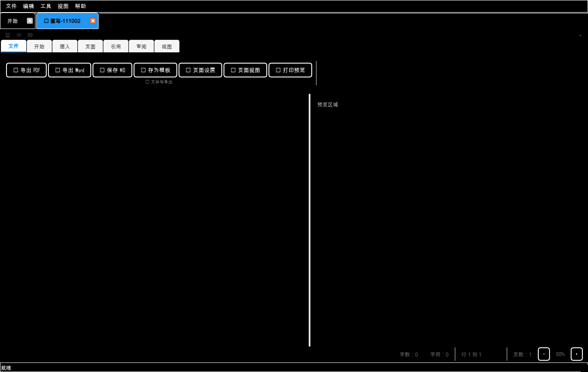

# 高对比度 / 显示基线与人工视觉审查（2026-11-05）

## 1. 高对比度主题

新增：

- 视图菜单 → “高对比度”（可勾选，持久化到 `settings.high_contrast`）；
- 黑底白字、黄色强调边框；
- 按钮/输入框/菜单/标签页/表头覆盖；
- 焦点边框 2px 强调色。

截图：



已知问题：

- 编辑器内部（Markdown/富文本/预览）已改为黑底白字；
- 部分插件内联样式未完全覆盖高对比度；
- 富文本内已有字符颜色可能仍是深色，需要在真实文档中逐项检查；
- 需要真实低视力用户/主题走查，当前只是基线覆盖。

## 2. 显示环境

实测：

| 项 | 值 |
|---|---|
| 屏幕数 | 1 |
| 分辨率 | 1536×864 |
| 可用区域 | 1536×824 |
| devicePixelRatio | 1.25 |
| logical DPI | 96 |
| physical DPI | 约 126.6 |

结论：

- 单显示器 + 125% 缩放下主界面/状态栏可用；
- **多显示器、切换主屏、跨屏拖动未实测**（环境只有 1 块屏幕）；
- 150%/200% 截图由 `QT_SCALE_FACTOR` 模拟，不是真实系统缩放。

工具：

```powershell
$env:QT_QPA_PLATFORM='windows'
python tools/display_audit.py --json _ptmp/analysis/display_audit.json
```

## 3. 人工视觉审查（100/150/200% + 英文）

| 基线 | 结论 |
|---|---|
| 100% 中文 | 正常 |
| 150% 中文 | 主要按钮/状态栏可读，无重叠 |
| 200% 中文 | Ribbon/状态栏明显紧凑；未发现文字截断，但空间接近下限 |
| 100% 英文 | 菜单/按钮无溢出 |

仍需：

- 200% 下进一步压缩 Ribbon 时验证；
- 英文长文案对话框；
- 真实多显示器/混合 DPI。

## 4. 工具

- `tools/ui_screenshots.py --contrast`：高对比度截图；
- `tools/display_audit.py`：屏幕/DPI 清单；
- `tools/ui_visual_diff.py --max-diff-percent`：视觉差异门禁。

## 5. 结论

高对比度与显示基线已建立，但“多显示器/混合 DPI”仍受当前单屏环境限制，不能宣称通过。


## 6. 高对比度逐项审计（2026-11-05）

新增 `tools/high_contrast_audit.py`，扫描硬编码浅色背景/深色文字：

| 指标 | 结果 |
|---|---:|
| 含硬编码颜色的文件 | **49** |
| 命中行数 | **187** |

主要集中：
- BeeSheet 工具栏/对话框/公式/审计；
- BeeShow 面板/历史/元素编辑；
- 导出、移动端、命令面板。

已修复：
- 蜜写 Markdown/富文本/预览；
- 查找替换栏；
- 大纲面板；
- 统一导航栏；
- 主题 `tokens()` 高对比度分支（Ribbon 等用 token 的控件自动跟随）。

未完成：
- 上述 49 个文件的内联 QSS 仍需逐个改为 `Theme.tokens()/button_qss()`；
- 富文本内已有字符颜色（用户设置的红/蓝等）在高对比度下可能仍不可读；
- 需要按插件逐页截图验收。

## 7. 缩放验收探针

新增 `tools/display_acceptance.py`，在真实桌面窗口下用
`QT_SCALE_FACTOR=1.0/1.25/1.5/2.0` 启动并检查：

| 缩放 | 状态栏 | 缩放控件 | 结果 |
|---|---|---|---|
| 1.0 | ✅ | ✅ | PASS |
| 1.25 | ✅ | ✅ | PASS |
| 1.5 | ✅ | ✅ | PASS |
| 2.0 | ✅ | ✅ | PASS |

注意：这是**单屏缩放模拟**，不是真实多显示器/混合 DPI。
