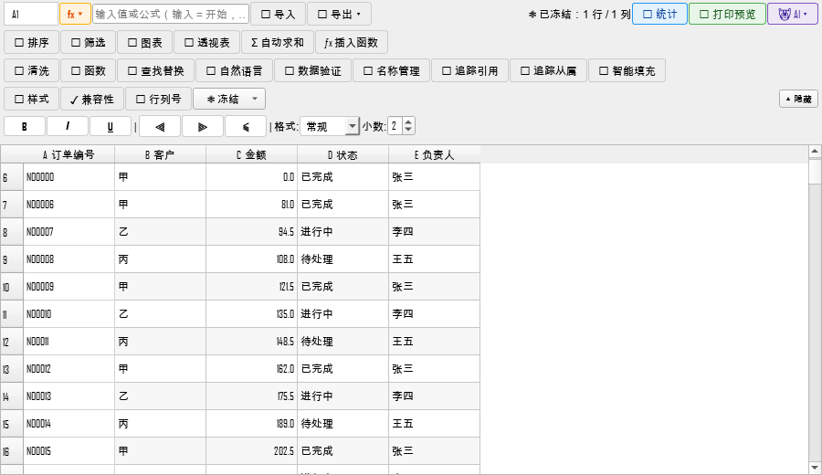

# 第 4 批 P0：冻结窗格 / 图标集写回 / 多级排序 / 阶段 1 线程安全（2026-10-22）

> 对应优化路线图第 4 批（v5.0.19 候选），四项均为矩阵 B 的 S 级"能力已在手里、
> 只差开关/写回/UI"项。全部有行为/产物级测试，不修改文件格式。

## 4.1 真实冻结窗格（`beesheet_freeze_mixin.py`）

**旧问题**：只保留文件里的 `freeze_panes` 状态，界面明确禁用；滚动时表头不会固定，
状态栏所谓"冻结信息"只是字符串。属于"假功能"。

**实现**：主表格视口内叠三个 QTableView（顶部冻结行 / 左侧冻结列 / 交叉角），
共享同一个 `SheetDataModel` 与委托：
- 顶部视图只显示前 top 行，横向滚动值跟随主表；
- 左侧视图只显示前 left 列，纵向滚动值 = 主表纵向值 + top（冻结行偏移）；
- 交叉角显示前 top 行 × 前 left 列；
- 列宽/行高从主表同步，主表滚动/尺寸变化时重新定位；
- 叠加视图可编辑（双击/回车），点选后同步主表当前单元格 → 公式栏联动。

**UI**：工具栏「❄️ 冻结」菜单、右键「❄️ 冻结窗格」子菜单：
冻结首行 / 冻结首列 / 冻结首行+首列 / 冻结到当前单元格 / 取消冻结。
`A1` 语义同 Excel（不冻结），`A2` 首行，`B1` 首列，`B2` 行列，`C3` 前 2 行 2 列。

**持久化**：仍走既有 `freeze_panes` 写回链；打开文件读回后自动恢复叠加视图。

**验证**：`tests/fidelity/test_beesheet_freeze_panes.py` 8 条：
解析、首行/首列/行列可见性、取消、保存 xlsx 后 `freeze_panes=="B2"`、
从持久化状态恢复、滚动同步。真实打开含冻结的 xlsx 后叠加视图出现在主视口上方。

**边界**：只支持左上冻结（与 xlsx/Excel 语义一致），不做拆分窗格；
叠加视图是"显示层"，不复制数据、不影响导出。

## 4.2 条件格式图标集写回（`beesheet_style_export.py`）

**旧问题**：`_apply_conditional` 只处理 data_bars/color_scale，`icon_set` 被
`continue` 跳过 → GUI 显示 🔴🟡🟢，保存 xlsx 后规则消失（静默丢失）。

**实现**：`icon_set` 写回 openpyxl `IconSetRule("3TrafficLights1", "num",
[min, min+step, min+2*step], showValue=True)`，与视图 3 档阈值一致。

**验证**：`test_beesheet_iconset_writeback.py` 3 条：
直接写规则、产品级 `_add_icon_set → _write_xlsx` 后用 openpyxl 读回 iconSet、
data_bars/color_scale 回归。

## 4.3 多级排序（`beesheet.py` / `beesheet_commands.py`）

**旧问题**：只有单列排序；用户需要多列时要反复排序，后一次覆盖前一次，
不是真正的多级排序。

**实现**：
- 对话框最多 3 个排序键（列 + 升/降序），第 1 级默认第 1 列、第 2/3 级可"（无）"；
- 一次 `sort_values(by=[...], ascending=[...], kind="mergesort")`，稳定排序；
- 只对**真实数据行**排序（`_real_rows`/`_full_df`），模型补齐的 1000 行空行
  不参与、不会排到前面；
- `SortCommand` 改为 `model.set_full_dataframe()`，排序/撤销同步 `_real_rows/_full_df`；
- `sort_by_column` 保留为单级兼容入口。

**验证**：`test_beesheet_multisort.py` 6 条：两级排序、旧单列接口、撤销、
空 keys、越界列、真实行不含填充行。

**边界**：排序不自动重映射内部公式/批注坐标（与既有单列排序一致），
后续单列"排序后引用跟随"专项处理。

## 4.7 阶段 1 UI 线程安全（`beesheet.py`）

**旧问题**：`_open_sheet_file` 把 `_import_file_from_path` 放工作线程，
函数内部直接 `setModel`、`resizeColumnToContents`、`set_current_file_path`、
`QMessageBox` 等 —— 跨线程操作 Qt，潜在崩溃/界面不刷新。

**实现**：
- `_read_sheet_payload(path)`：工作线程只做纯读取（CSV/工作簿/回退 pandas），
  不碰任何 QWidget；
- 读取完成发 `import_ready(payload, path)` 信号回主线程；
- `_apply_sheet_import_payload`：主线程唯一碰 Qt 的地方（模型、页签、样式、
  状态栏、>20 万行询问、启动阶段 2）；
- 主线程直接调用时保持同步读取+应用，既有脚本/测试路径不变；
- 工作线程异常交给 `AsyncTaskManager.on_error` 在主线程提示。

**验证**：既有 79 条相关回归（两阶段载入/工作簿/页签/UI/冻结/排序/图标集）
全过；其中 `test_phase2_auto_completes_from_worker_thread` 覆盖工作线程导入。

## 测试与门禁（已完成）

- 新增 **17 条**测试（冻结 8 + 图标集 3 + 多级排序 6），全部通过；
- 相关回归 **220 passed / 1 skipped**（蜜算全部测试 + 打开/保存/标签/两阶段 + UI）；
- 干净 worktree（commit `ae6adb2`）：**46/46 门禁 PASS**（11.9 分钟）
  + 全量 **1585 passed / 4 skipped / 0 failed**（787.08 s）；
- 本次不做版本发布：v5.0.19 待 4.4/4.5/4.6 一起收口。

## 已知边界

- 冻结窗格是"左上冻结"叠加视图，不支持拆分窗格；冻结行/列可编辑（共享同一 model），
  但叠加视图不显示行号（主表行号仍可对照）；
- 图标集写回是 3 档交通灯（与视图显示一致），不做自定义图标/阈值；
- 多级排序不自动重映射内部公式引用表/批注坐标（与既有单列排序一致）；
- 阶段 1 的样式读回仍在主线程（`_load_view_styles_from`），大表样式读回已有阈值门；
  后续可把纯样式读取也移到工作线程（需再拆分 I/O 与 apply）。
