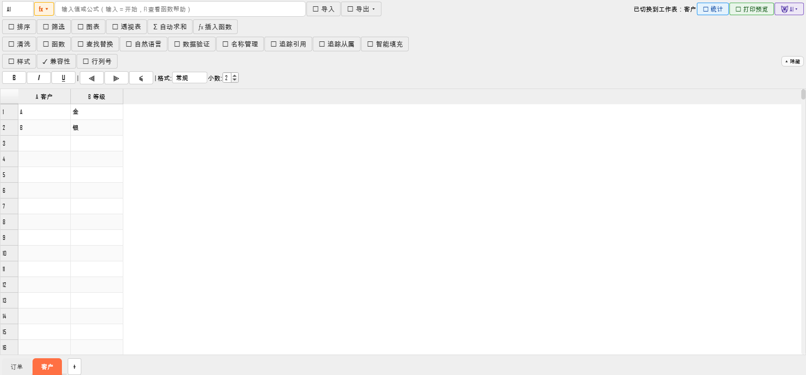

# WPS 式 UI 提升 · 第 2 批（2026-10-22）

> 目标：按用户要求「对比 WPS 的 UI 重塑 BeeOffice；Word 要有 WPS 版式的页面设计；Excel 要有 WPS 式初始行列与 sheet 页签」。
> 本轮全部为**真实运行验证 + 回归测试**，不修改文件格式、不影响既有导出。

## 1. 蜜算 BeeSheet：WPS 式工作表页签

**改动**（`beesheet_ui_mixin.py` / `beesheet_data_mixin.py` / `beesheet.py`）：
- 表格底部新增 **QTabBar 页签栏**（＋新建按钮）：显示工作簿全部工作表，
  点击切换、右键「新建 / 重命名… / 删除工作表」；
- 切换时先把当前编辑的 DataFrame **回写工作簿对象**，再加载目标表；
  保存仍然走 `write_workbook`，**其他工作表与公式不丢**；
- 两阶段载入的大表在完整数据未就绪时禁止切换（提示"仍在后台加载，请稍候"），
  避免拿半份数据写回；
- 新建/重命名/删除会触发 `contentChanged`，标签页"● 未保存"标记能亮。

**实测**（离屏真实打开 2 工作表 xlsx）：1.8 s 打开、页签 `['订单','客户']` 可见、
切到「客户」后单元格为 `A`；截图见上。

**限制**：
- 切换工作表时样式读回是同步的（大文件会跳过，见样式读回阈值）；
  目前只把**当前编辑表**作为模型，其他表在保存时原样写回；
- 大表后台补全期间不能切换（这是有意的安全门）。

## 2. 蜜算：WPS 式「列字母 + 行号」

- `SheetDataModel.headerData` 默认显示 `A  订单编号`、`B  金额`…（列字母 + 列名），
  行号从 1 开始；工具栏新增 **🔠 行列号** 开关，可切回纯列名显示。
- 公式/引用/导出坐标**完全不变**（只改表头显示），既有 113 条公式引擎测试与
  工作簿往返测试不受影响。

## 3. 蜜写 BeeWrite：页面视图按「页面设计」渲染

- 原「打印预览」写死 **A4**，忽略页面设置；现在新增 `_build_page_printer()`：
  按当前文档 `_page_settings` 的**纸张（A4/A3/A5/Letter/Legal）、方向（纵向/横向）、
  四向页边距（mm）** 构造 QPrinter，页面视图/打印预览所见即所得；
- 工具栏按钮由「🖨️ 打印预览」改为「📄 页面视图」（tooltip 说明按页面设置显示），
  与 WPS 的「页面视图/打印预览」入口对齐；
- 导出 PDF 复用同一 `_document_for_print()` 链路（既有 P0 测试覆盖）。

## 4. 测试与门禁

- 新增 `tests/fidelity/test_ui_wps_layout_2026_10_22.py` **6 条**：
  页签显示 / 切换加载目标 DataFrame / 新建·重命名·删除 / 真实打开多工作表 /
  WPS 表头 / 页面视图按页面设置构造 QPrinter；
- 相关回归 **77 条**（蜜算两阶段载入、工作簿、导出接线、UI 细节、P0 修复）全过；
- i18n：本批新增 18 条中文 UI 文案走「中文优先」路线，棘轮基线
  3598 → **3616**（已在 `tools/i18n_baseline.json` 记录，后续按模块 tr 化时统一处理）；
  `i18n-ratchet` 门禁通过；
- `packaging` 门禁通过；locale 键数 226→（未改）仍为 226。

## 5. 下一批（已排期）

1. **PDF 页面/权限工具**（WPS 会员唯一低成本可追平项）：`beecmd pdf-merge/split/extract/delete/encrypt/watermark/text/images`；
2. 蜜写：页眉页脚编辑 UI（后端已有 section_parts）、表格跨页重复标题行导出（`w:tblHeader`）、页码体系（起始页/罗马数字）；
3. 蜜算：真实冻结窗格、多级排序/筛选 UI、组合图；
4. 蜜演：修复已完成（加页），下一批做幻灯片版式/母版与演讲者视图细节。
