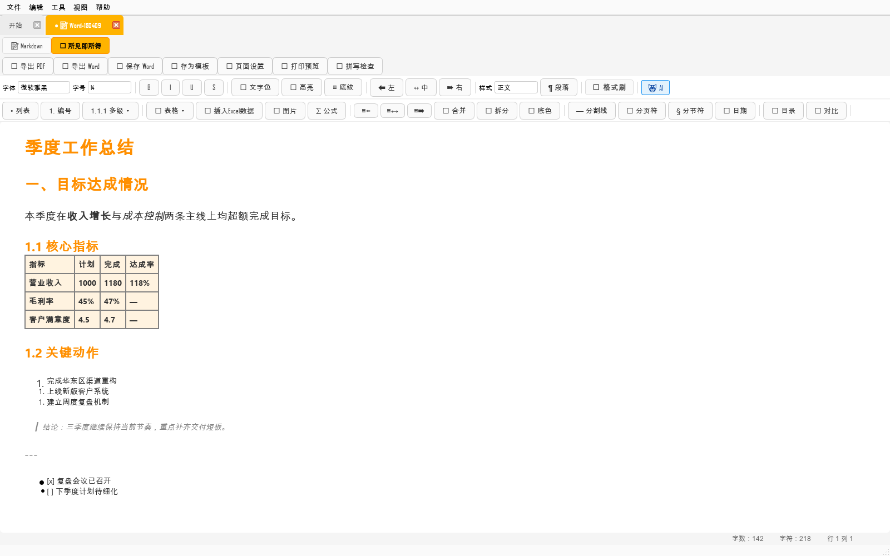
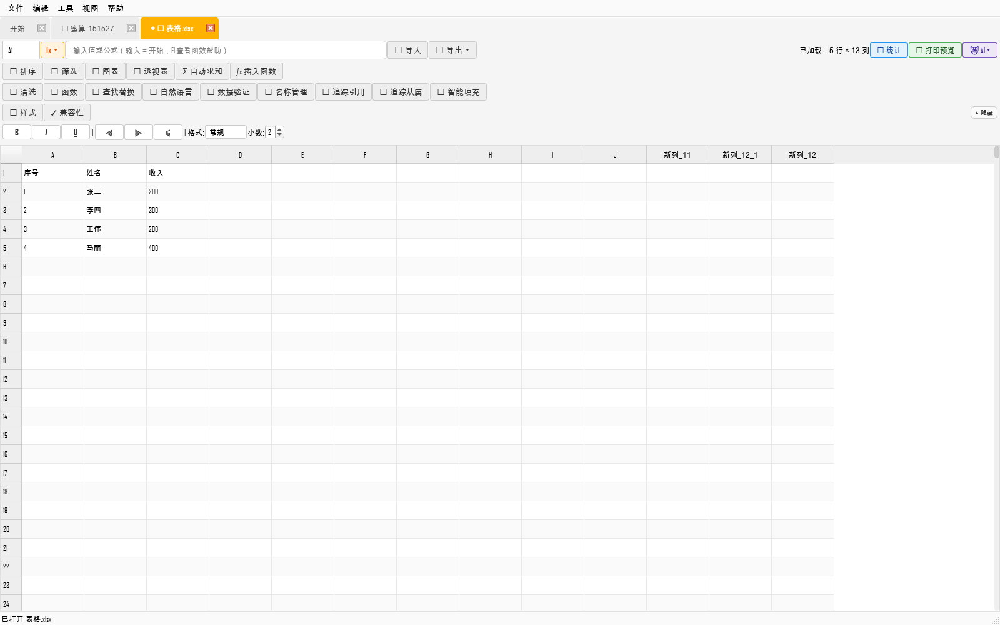
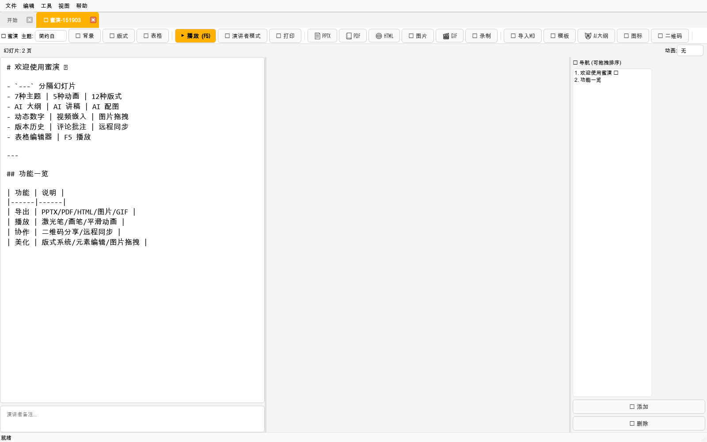
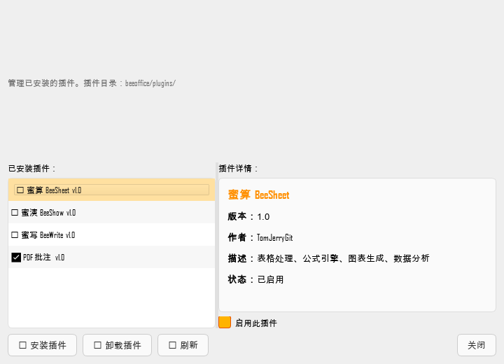

# BeeOffice 全面运行报告 × WPS / WPS 会员对比 × 下一步优化路线

> 日期：2026-10-21 · 对象：BeeOffice v5.0.17（`D:\beeofficeV`，tag `v5.0.17`=`ddb390c`）
> 方式：**离屏真实启动 GUI 并驱动操作**（PySide6 offscreen + 自动截图）+ 性能基准 + 插件/功能盘点 + WPS 公开资料调研。
> 证据：截图 59 张（本报告附 18 张关键图）、GUI 盘点 2.0 万字、性能 14 场景 × 27 runs、WPS 对比矩阵 38 行。
> 边界：本机沙箱禁止命名管道 → 依赖 `QWebEngineView` 的蜜演预览/F5 播放/部分 PDF 导出**本机不可测**（真机可用）；WPS 仅做公开资料调研，**未登录、未启动 WPS**。所有数字均为本机实测（A）或明确标注代码推断（B）。


---

## 0. 执行摘要（一页）

| # | 结论 |
|---|---|
| 1 | **软件本身能跑、能编辑、能打开真实语料**：蜜写/蜜算/蜜演三件套、17 个关键对话框、DOCX/XLSX/PPTX 全部真实打开；4 个内置插件全部加载（21 ms），主窗口构造 275 ms。 |
| 2 | **冷启动 0.83–0.94 s**（离屏 inner；子进程墙钟 1.08–1.28 s），比仓库旧文档的 4.5–10 s 好——旧数字含真机显示/首启初始化，本报告口径为"到首个事件循环"。 |
| 3 | **打开性能量级正常**：5 万字 DOCX 1.70 s（进程内首次 4.12 s，含插件一次性导入）、2.54 MB 带图 DOCX 1.30 s、30 万行 XLSX 首屏 1.53 s、PPTX 30 页导入 0.66 s。 |
| 4 | **发现 2 个 P0 产品缺陷（本次实跑新增）**：① 30 万行大表"后台补全"自动链路**完成回调丢失**——用户永远只见首屏 1000 行（手动主线程调同一函数 34.4 s 可完成；Lead 用真实入口复现：100 s 后仍 1000 行）；② 稀疏大表（2.28 MB、声明 20 万行）打开 **62.5–142.8 s**，卡在 `read_view_styles` 全表扫（119–154 s、60 万格式项），既有 >5 MB 阈值挡不住。 |
| 5 | **发现 1 个 P1 逻辑 bug**：蜜演「新增幻灯片」页数 2→2 不变，新标题与第 1 页粘连为 `新幻灯片# 欢迎使用蜜演 🎥`（`_add_slide` 插入串缺结尾换行、且从文首插入）。 |
| 6 | **发现 6 条低成本 UI/文案问题**：取消另存为显示「保存失败」；保真提示对 note-only 报告文案矛盾；大纲自动编号与手写编号叠加；快捷键浮层 Markdown 未渲染；菜单旧名「WebDAV 设置」；拼写检查无后端但仍可点。 |
| 7 | **插件体系健康但生态为零**：扫描 99 模块 → 加载 4 → 跳过 95；4 个壳都只 `create_widget/register_commands`，无插件注册菜单；插件市场只列内置插件；无插件签名/公开 API 文档。 |
| 8 | **与 WPS 相比**：WPS 免费版已覆盖三件套基础编辑；付费墙在 PDF 全套、云空间、模板素材、AI、额度。38 行矩阵：**对齐/反超 9、部分 13、缺失 16**。BeeOffice 真正优势是**本地/可编程/可审计/零额度 AI/轻量无广告**；**唯一低成本的会员功能对标空间 = PDF 页面级 + 权限级工具**（PyMuPDF 已是必需依赖）。 |
| 9 | **战略判断不变且被本轮数据强化**：不做"另一个 WPS"；把资源投在"本地优先的文档自动化与 AI 流水线"，编辑器只是前端。云盘/模板/协作/PDF 转换 OCR/365 平台/点数计费**明确不做**。 |
| 10 | **下一步最优解**：先修 3 个真实缺陷（P0×2 + 蜜演加页）+ 1 批 UI 文案（≤1 周），再用 PyMuPDF 做 `beecmd pdf-merge/split/encrypt/watermark`（1–2 周，唯一可追平的会员能力），随后做大表 UX/版本时间线/启动预热（1–2 月）。验收指标见 §8。 |

---

## 1. 运行方法与证据边界

### 1.1 环境

| 项 | 值 |
|---|---|
| 机器 | HP ProBook 440 G5 / i7-8550U（4C/8T，1.8 GHz）/ 7.9 GB RAM / Win10 19041 / NTFS |
| Python | 3.11.9；PySide6 6.6.0；pandas 2.2.2；openpyxl 3.1.5；python-calamine 0.9.0 |
| BeeOffice | 5.0.17（源码树 + PyInstaller 发行包 `BeeOffice-v5.0.17-windows.zip` 225.4 MB / 3130 条目 / sha256 `6ce6431a…`） |
| 本机 WPS | **WPS Office 12.1.0.29161 已安装**（`AppData\Local\Kingsoft\WPS Office\12.1.0.29161\office6\wps.exe`；不在 PATH；全程未启动） |
| 本地 AI | Ollama `llama3.2:latest`（2.0 GB，已安装，本轮未跑生成任务） |
| 隔离 | HOME/USERPROFILE 指到临时目录、`BEEOFFICE_DRAFT_DIR` 指到空临时目录；`QT_QPA_PLATFORM=offscreen`、`QT_QPA_FONTDIR=C:\Windows\Fonts`（否则中文豆腐块） |

### 1.2 证据清单（可直接打开）

| 证据 | 文件 |
|---|---|
| GUI 实跑盘点（菜单/对话框/插件/问题/复现） | [01-GUI实跑盘点.md](全面运行-证据-2026-10-21/01-GUI实跑盘点.md) |
| 性能基准（14 场景 × 27 runs + 归因） | [02-性能基准.md](全面运行-证据-2026-10-21/02-性能基准.md) |
| WPS/WPS 会员调研与 38 行矩阵（21 条来源） | [03-WPS会员调研与对比.md](全面运行-证据-2026-10-21/03-WPS会员调研与对比.md) |
| 关键截图（18 张，全部真实 `QWidget.grab()`） | [screens/](全面运行-证据-2026-10-21/screens/) |
| 原始数据 | `_ptmp/analysis/compare/app_raw.json`、`perf_raw.json`、`wps_sources.json` |
| 复跑脚本 | `_ptmp/analysis/compare/_runner_*.py`、`run_bench.py`、`bench_*.py` |

### 1.3 不可测项（如实）

1. 本机沙箱禁止命名管道：真实 `QWebEngineView` 实例化即 FATAL（`platform_channel.cc(85) 0x5`）→ 蜜演预览、F5 播放、激光笔、PDF/图片导出未测；**用真实版截图 + 哑元控件完成其余 UI 验证**。真机可测。
2. 未登录 WPS 账号、未启动 WPS → WPS 侧所有结论来自公开资料，价格按"官方声明+官方社区+媒体"分层标注，不可当财务依据。
3. AI 真实 LLM 调用未测（无 API Key；已测"未配置 Key → 明确询问是否本地规则降级"路径）。
4. 云同步真实传输未测（无服务器）。
5. 离屏渲染的 emoji 缺字体（显示 □），真机 GUI 用 Segoe UI Emoji 不受影响。

---

## 2. 实际运行结果

### 2.1 启动与主界面

| 指标 | 实测 |
|---|---:|
| `BeeApp()` 构造（离屏） | **275 ms**（另测 124–374 ms） |
| 冷启动到事件循环 ready（新进程） | **0.83 / 0.86 / 0.94 s**（中位 0.86 s）；outer 1.08–1.28 s |
| 插件发现+加载 | **21 ms**（扫描 99 模块→候选 4→跳过 95） |
| 菜单 | 5 个顶级菜单、56 个菜单项、150 个 QAction（含快捷键/启用状态） |
| 首屏 | 1600×1000，light/amber 主题，欢迎标签 |

菜单结构（实跑抓取）：文件（新建/打开/保存/导出/最近打开/退出）、编辑、工具（AI 辅助/恢复草稿/数据分析/透视表/自然语言公式/关联表格/批量转换/PDF 批注）、视图、帮助（AI 设置/云存储设置/备份与恢复/插件市场/内存监控/关于）。截图 `03_menu_*.png`。

### 2.2 三件套实跑



| 场景 | 结果 | 耗时 |
|---|---|---:|
| 新建 Word（`_new_word_doc`，自动 rich_text） | ✅ | 1209 ms |
| 写入 H1/H2/H3、表格、列表、引用、粗斜体并渲染 | ✅ 324 字符 / 9308 B HTML | 1046 ms |
| 打开 5 万字 DOCX | ✅ 55,380 字符 / 1,094 段 / 0 图 | **1.70 s**（首次 4.12 s） |
| 打开 2.6 MB 带图 DOCX | ✅ 3,733 字符 / 97 段 / 24 图 | **0.97–1.50 s** |
| 大纲面板 | ✅ 4 个标题项 | 906 ms |
| 查找栏 / 拼写检查 | ✅ / ❌ 无后端（提示清晰） | — |
| AI 续写（无 Key） | ✅ 明确询问是否用本地规则，不崩 | 1027 ms |
| 保真分析（打开时） | ✅ 5 万字文档报「目录域 86 处（medium）」 | 29–54 ms/文件 |



| 蜜算场景 | 结果 | 耗时 / 内存 |
|---|---|---:|
| 新建表格 | ✅ | 2103 ms |
| 打开 6×13 真实表格 | ✅ | 1239 ms / RSS 174 MB |
| 打开 30 万行表（首屏） | ⚠️ 仅 1000 行；**后台补全永不生效**（P0-1） | 1.53 s；RSS 185 MB |
| 打开 2.28 MB 稀疏「20 万条」 | ⚠️ **62.5 s / 142.8 s**（样式读回，P0-2） | RSS 324→528 MB |
| 透视/筛选/图表/智能分析对话框 | ✅ 真实弹出 | 0.8–3.5 s |
| 载入中点透视/筛选 | ❌ 被安全门拦截且**提示"请重新打开文件"**（误导） | — |



| 蜜演场景 | 结果 | 耗时 |
|---|---|---:|
| 新建蜜演 | ✅ 2 页欢迎页 | 1514 ms |
| 主题切换（7 种）/ 动画（5 种） | ✅ | — |
| **新增幻灯片** | ❌ **页数 2→2 不变，标题粘连**（P1-1） | — |
| 导入 PPTX（30 页） | ✅ 7,106 字符 / 30 条备注；损失清单「图表×3、表格×11」 | 657 ms |
| 导入 PPTX（28 页） | ✅ 5,070 字符 / 28 条备注；「图表×8、表格×7」 | 488 ms |
| F5 播放 / 导出 PDF / 图片 | ⛔ 本机 WebEngine 受限，真机可测 | — |

### 2.3 对话框与插件

17 个关键对话框全部由真实入口打开并截图：AI 设置、云存储设置、备份与恢复、插件市场、命令面板、模板选择（14 个模板/6 分类）、内存监控、快捷键浮层、智能数据分析、透视表、筛选、图表类型、保真提示、关于、拼写检查不可用、AI 不可用、PPTX 导入损失清单。




插件实测：`PluginManager` 扫描 99 模块 → 4 个插件壳全部加载、全部启用；插件市场列出 4 个内置插件（蜜算/蜜演/蜜写/PDF 批注 v1.0，作者 TomJerryGit），支持启用/卸载/刷新。插件目录共 100 个 `.py`，96 个为实现模块不参与发现。

---

## 3. 性能实测（本机 A 级，离屏，新进程）

### 3.1 关键数字

| 场景 | 实测（中位/范围） | 说明 |
|---|---:|---|
| 冷启动 → 事件循环 ready | **0.86 s**（0.83–0.94） | outer 墙钟 1.08–1.28 s；纯 import app 0.65 s |
| 5 万字 DOCX 打开 | 4.12 s（首次）/ **1.70 s**（后续） | 首次含插件一次性导入 |
| 2.54 MB 带图 DOCX | **1.30 s** | 24 张图 |
| 30 万行 XLSX 首屏 | **1.53 s** | 只显示 1000 行 |
| 30 万行后台补全（自动链路） | **未完成**（100 s 仍 1000 行） | 手动主线程 34.4 s 可完成 → P0-1 |
| 稀疏「20 万条」产品打开 | **62.5 s / 142.8 s** | 样式读回 119–154 s → P0-2 |
| 自建 5000×13 XLSX 打开 | 5.23–5.46 s | 样式读回是主要成本 |
| DOCX 导出 / PDF 导出（500 段） | **280–498 / 254–360 ms** | 产物校验 521 段 / 36 页 |
| 1000×20 XLSX 保存 | **661–792 ms** | 覆盖保存 |
| `.beshow` 保存 / PPTX 导出 | 30 ms / 386 ms（首次 3.58 s） | 3 页 |
| CLI `beecmd --version` | 178 ms | `version` 子命令不存在（exit 2） |
| CLI convert / merge / clean / verify | 2.0–2.3 / 1.5–1.6 / 1.4–1.5 / 1.7–2.1 s | 全部 exit 0 |
| 内存 RSS | 69.9 MB 启动 → 185 MB 首屏 → 443 MB（补全数据在内存未上屏） → 229 MB 关窗 | 粗略 |

### 3.2 两个 P0 的归因（已独立复核）

**P0-1：30 万行后台补全回调丢失。**
`_import_file_from_path` 在工作线程里执行；结束时它在**工作线程内**再调用 `_start_phase2_full_load()` → `AsyncTaskManager.run(...)`，完成回调没有落到模型上（RSS 已涨到 443 MB，说明数据已在内存）。Lead 用真实入口 `BeeApp._open_sheet_file` 独立复现：10/20/35/50/75/100 s 全部 `rows=1000, is_fully_loaded=False`，状态栏甚至显示「就绪」。而把同一 `_start_phase2_full_load(path)` 从**主线程**调用：34.4 s 后 `rows=200001, is_fully_loaded=True`。
→ 用户可见后果：打开 20/30 万行表**永远只见首屏 1000 行**，透视/筛选/图表被安全门拦下并提示"请重新打开文件"。

**P0-2：稀疏大表样式读回全表扫描。**
`_load_view_styles_from → read_view_styles` 用 openpyxl 非 read_only 加载并 `iter_rows()` 扫满 `<dimension>` 声明的 200,001×13（约 260 万格）；单次 119.1/145.2/153.8 s，返回 60 万格式项。产品只在 **>5 MB** 才跳过样式读回，2.28 MB 的稀疏表正好踩中。既有大表文档只测了 `read_workbook`（2.1 s），未覆盖"产品打开"这条链路。

### 3.3 与仓库既有基线文档的差异

| 项 | 2026-10-21 文档基线 | 本机复测 | 解释 |
|---|---:|---:|---|
| 5 万字 DOCX 首开 | 2.07–2.37 s | 4.12 s（首次）/1.70 s（后续） | 本机低压 CPU + 首次插件导入；后续 run 与基线同量级 |
| 2.54 MB DOCX | 0.73–0.78 s | 1.23–1.50 s | 机器/负载差异（本机 7.9 GB/69% 占用） |
| 30 万行首屏 | 2.0 s | 1.53 s | 缓存热，本机更快 |
| 30 万行后台补全 | 17.2 s | 自动链路**未完成**；手动主线程 34.4 s | **本次复现出回调丢失；基线当时的正结果是另一条调用路径** |
| read_workbook 30 万行 | 15–23 s | 8.1–9.5 s（热）/20.5–22.4 s（首次） | 缓存状态差异 |
| 稀疏 20 万条 read_workbook | 2.1 s | 0.48 s（热）/1.51–1.76 s（首次） | 一致；但**产品打开未覆盖**（P0-2） |

---

## 4. UI / 交互审查

### 4.1 做得好的

- 主界面清爽：五菜单 + 标签页 + 状态栏 + 欢迎页，三件套入口明确；主题/强调色成熟（light/dark + amber/ocean/forest/sunset）。
- 对话框体系完整：AI 设置、云存储、备份恢复、插件市场、模板、命令面板、内存监控全部真实可用；PPTX 导入/保真提示会把损失**列出来**，不假装无损。
- 快捷键（Ctrl+S 等）、长按 Ctrl 浮层、未保存标记、自动保存、文件监视等 P0 止血能力都在。

### 4.2 需要修的（按严重度）

| 级别 | 问题 | 证据 | 建议 |
|---|---|---|---|
| P0 | 大表补全回调丢失（见 §3.2） | 真实入口复现 100 s 仍 1000 行；`perf_logs/debug_sheet30*.log` | 保存 Worker 引用/把 phase2 回主线程 `QTimer.singleShot(0)` 再启动；状态栏显示进度；加回归测试 |
| P0 | 稀疏大表打开 60–143 s | `read_view_styles` 119–154 s / 60 万格式项 | 按声明行数/文件大小跳过或限制样式读回；>5 MB 阈值改为"声明行数 ≥5 万或文件 ≥5 MB" |
| P1 | 蜜演「新增幻灯片」无效 | before=2/after=2；标题 `新幻灯片# 欢迎使用蜜演 🎥`；`screens/42_show_add_slide.png` | 插入串改 `\n\n---\n\n## 新幻灯片\n\n`，插入点移到文末/当前页后，插入后光标移到新页 |
| P2 | 取消另存为显示「保存失败」 | word/sheet/show.json status | 取消 → 「已取消保存」；仅真实失败才报失败 |
| P2 | 保真提示 note-only 文案矛盾 | `items=[]`、`summary=未发现无法保真的构造`，却弹「有内容无法完整保留」 | note-only 用说明性文案；有 items 才用"无法保留" |
| P2 | 大纲自动编号叠加手写编号 | `1.1 一、目标达成情况` | 检测已有编号时停止自动编号，或提供开关 |
| P2 | 快捷键浮层 Markdown 未渲染 | 显示 `## 全局`、反引号 | `setMarkdown()` 或渲染 HTML |
| P2 | 菜单旧名「☁️ WebDAV 设置」 | 对话框标题是「云存储设置」 | 统一 zh_CN.json 文案 |
| P3 | 拼写检查无后端但可点 | 提示完整但按钮不置灰 | 启动探测后置灰 + tooltip 给安装指引 |
| P3 | 大表载入提示"请重新打开文件" | `screens/dialog_msg_warning_无法透视表.png` | 阶段 2 进行中 →「数据仍在后台加载（预计 X 秒），等待/取消？」 |

另外：README「界面预览：截图待补充」与功能清单里仍有已移除条目（中英文国际化、页眉页脚等），建议用本报告截图与"已移除"标注更新——这是低成本、直接提升首次印象的项。

---

## 5. 插件体系评估

| 维度 | 现状 | 结论 |
|---|---|---|
| 发现机制 | 扫 99 模块 → 4 壳（`*_plugin.py`），21 ms，不误拉 pandas/matplotlib/PyMuPDF/WebEngine | 健康，设计正确 |
| 内置插件 | 蜜写/蜜算/蜜演/PDF 批注 v1.0，全部启用；各含 14–18 个命令 | 够用 |
| 扩展点 | 4 个壳只实现 `create_widget`/`register_commands`；无人覆盖 `register_menus`；菜单集中 `menus.py` | 插件能力只进命令面板，**无法改变菜单/UI 结构** |
| 市场 | 本地插件市场只列内置插件；无下载/签名/权限模型 | 无第三方生态 |
| 风险 | 无插件签名、无沙箱、无 API 文档；`plugin_market.py` 的安装/下载路径若启用需先做校验 | 商业化前必须补 |
| 建议 | 短期：插件 API 文档 + `register_menus` 示例 + 签名清单；中期：插件市场只做"本地安装包 + 校验哈希"，不做在线商店 | P2 |

---

## 6. 与 WPS / WPS 会员全面对比

> WPS 侧事实：本机安装 **WPS Office 12.1.0.29161**；2026 年在售会员精简为**超级会员/大会员**两类（官方 2026-07 声明），AI 只在大会员；2026-08 起灵犀改「灵点」独立点数（800 点/月免费、48–398 元/月、31 天清零、大会员不抵扣）。详细来源与 38 行矩阵见 [03-WPS会员调研与对比.md](全面运行-证据-2026-10-21/03-WPS会员调研与对比.md)（S1–S21）。

### 6.1 关键档位与价格（公开资料，非财务依据）

| 档位 | 关键权益 | 价格（公开口径） |
|---|---|---|
| WPS 免费版 | 三件套基础编辑；云 1 GB/单文件 10 MB；PDF→Word 仅前 5 页；PC 端 PDF 批注免费；有广告 | 0 |
| WPS 超级会员 | PDF 转换/编辑/水印/签名、云空间扩容（最大 365 GB）、稻壳模板 100 次/月、去广告、历史版本 180 天、OCR 等 | 约 148 元/年（不含 AI） |
| WPS 大会员 | 超级会员 + AI（历史额度 200/1000 次/月） | 约 348 元/年 |
| 灵犀（点数制，2026-08 起） | 800 灵点/月免费；标准 48 元/5000 点、进阶 128 元/14000 点、旗舰 398 元/48000 点；31 天清零、大会员不抵扣 | 见左 |
| WPS 365 企业版 | 智能文档/表单/多维表格/协作/会议/邮箱/私有化；2 TB 存储（旗舰） | 199 / 399 / 599 元/人/年 |
| 稻壳会员 | 800 万+模板、云字体/图标/图表 | 约 89 元/年（静态页，时效未核） |

### 6.2 38 行矩阵（浓缩版；完整见证据文件）

| 能力 | WPS 免费 | WPS 会员增量 | BeeOffice 现状 | 差距 | 成本 |
|---|---|---|---|---|---|
| 文字/表格/演示基础编辑 | 强 | 无额外 | 三件套可用，深度不及 | 部分 | L |
| 打开 DOCX/XLSX/PPTX | 强 | 无额外 | docx/xlsx 可；pptx 导入丢版式；.doc/.xls 不支持写 | 部分 | M/L |
| 格式保真 + 损失可申报 | 强（不申报） | 无 | **保真报告 + 50 份真实语料 + beecmd verify** | 对齐（差异化） | S |
| PDF 转 Word/Excel/PPT | 前 5 页 | 无限次 | 无 | 缺失 | L（不做） |
| PDF 内容编辑 | 不可用 | 会员 | 无 | 缺失 | L（不做） |
| **PDF 页面管理（合并/拆分/提取/删页/插页）** | 不可用 | 会员 | **无，但 PyMuPDF 已依赖** | 缺失 | **S（可做）** |
| PDF 批注 | PC 免费 | 移动端完整 | 高亮/下划线/删除线/文字注释、撤销、旁挂/烧录 | 对齐 | S |
| **PDF 加密/权限** | 免费 | 无额外 | 无 | 缺失 | **S（可做）** |
| **PDF 水印** | 不可用 | 会员 | 无（仅文档水印） | 缺失 | **S（可做）** |
| PDF 签名/图章 | 不可用 | 会员 | 无（仅文字注释） | 缺失 | M（可做图片签名） |
| PDF OCR / 翻译 / 转换 | 部分 | 会员 | 无 | 缺失 | L（不做） |
| 云空间 / 多端同步 | 1 GB | 最大 365 GB | 同步目录 + 3 适配器，未真机联调 | 缺失 | L（不做） |
| 历史版本 | 30 天 | 180 天 | 本地备份中心 + 草稿（无时间线 UI） | 部分 | S（可做） |
| 模板/稻壳/素材 | 少 | 800 万+ | 14 个内置模板 | 缺失 | L（不做） |
| AI 写作/表格/演示 | 不可用 | 大会员 + 灵点 | GUI AI + `beecmd ai` 六任务；BYO-Key/Ollama | 对齐（形态不同） | S |
| AI 计价方式 | — | 348 元/年 + 48–398 元/月、31 天清零 | **零额度、不清零、可离线** | **反超** | S |
| 协作/表单/多维表格/思维导图 | 无 | 部分/365 | 无 | 缺失 | L（不做） |
| 可编程/自动化 | VBA/JS/365 接口 | 部分 | `beecmd` 七命令 + 独立 exe + audit.jsonl | **反超** | S |
| 保真可验证 | 无 | 无 | 对齐（竞品不做） | **反超** | S |
| 广告/强制登录 | 有广告 | 去广告 | 无广告、不强制登录 | **反超** | S |
| 安装体积/启动 | 2.67 GB / 未测 | 同 | 225 MB 包；启动 ~0.86 s | 部分 | M |
| 更新器/代码签名 | 完善 | 完善 | 全缺失 | 缺失 | M（商业化前置） |
| 中文拼写检查 | 2026 春季新增 | 无额外 | 英文拼写、中文明确不做 | 部分 | M/L |

**统计**：对齐/反超 **9** 行、部分 **13** 行、缺失 **16** 行。

### 6.3 结论

1. **WPS 会员卖的是"云 + 内容 + 额度 + 去广告"，不是编辑器功能**；免费版三件套已够用，BeeOffice 在"编辑器深度"上不可能追平，也不应追。
2. **WPS 的结构性盲区恰好是 BeeOffice 的机会**：可编程（beecmd）、可审计（保真/verify）、零额度本地 AI、离线内网、轻量无广告。这些是"卖点"，不是"待补功能"。
3. **唯一值得对标且工程上便宜的会员能力 = PDF 页面级/权限级工具**（合并、拆分、提取、删页、插页、加密、水印、图片签名）——因为 PyMuPDF 已是必需依赖，且可与 `beecmd` 结合形成"命令行 PDF 流水线"，直接服务"可编程"定位。
4. **明确不做**：云盘、模板/素材/字体生态、多人实时协作、在线表单/多维表格/思维导图、PDF 转换/OCR/全文翻译、WPS 365 式企业平台、AI 点数计费。理由：经济学不成立（重资产/内容运营/网络效应），且会稀释"本地优先 + 可编程 + 可审计"的定位。

---

## 7. 下一步优化路线（按 ROI 排序）

### P0：本周内（正确性/性能红线）

| # | 动作 | 验收（可验证） | 证据/位置 |
|---|---|---|---|
| P0-1 | 修大表后台补全回调丢失：phase2 回主线程启动 + 保存 Worker/signals 引用；状态栏显示「后台加载 x% / 行数」 | 打开 30 万行表：**自动**完成 ≤45 s、`rows=200001`、`is_fully_loaded=True`、状态栏可见；连续打开 3 次无泄漏；新增回归测试 | `beesheet.py:586`、`async_task.py:66` |
| P0-2 | 修稀疏大表样式读回：声明行数 ≥5 万或文件 ≥5 MB → 限制/跳过 `read_view_styles`（至少不扫满 dimension）；对普通表保持现状 | 「20 万条」产品打开 **≤5 s**；样式读回不再产生 60 万项；普通 xlsx 样式保真测试全过 | `beesheet_style_export.py:285`、`beesheet.py:721` |
| P0-3 | 修蜜演「新增幻灯片」：插入串结尾换行 + 插入到文末/当前页后 + 光标落到新页 | 2 页 → **3 页**；标题分别「欢迎使用蜜演 🎥」「功能一览」「新幻灯片」；截图回归 | `beeshow_slide_mixin.py:352` |
| P0-4 | UI 文案批修：取消保存=「已取消保存」；note-only 保真提示改用说明性文案；载入中提示改「正在后台加载，等待/取消」 | 对应 3 条复现步骤全部改观；新增 3 条 UI 回归 | `beeshow/sheet/word` 保存链路、`app.py` 保真提示 |

### P1：1–3 周（追平 WPS 会员唯一可行项 + 体验）

| # | 动作 | 验收 |
|---|---|---|
| P1-1 | **`beecmd pdf-*`**：`pdf merge/split/extract/delete/insert/encrypt/watermark`（PyMuPDF），可选 `--json` 审计；不做内容编辑/转换/OCR | 7 条命令各 1 个真实 PDF 用例 exit 0；产物页数/大小/权限校验；10+ 测试；文档 `docs/beecmd-PDF工具.md` |
| P1-2 | 大表 UX：单表 20 万行上限明示（打开前/状态栏），加载进度/取消，限制并发阶段 2 只跑 1 个，内存回落 | 30 万行表打开提示"仅前 20 万行"；取消后 RSS 回落；连续开 3 个大表不 OOM |
| P1-3 | 本地历史版本时间线：备份中心按时间列版本、预览、恢复（复用 backup/drafts） | 修改→保存 3 次→可看到 3 个版本并恢复任意一个；测试覆盖 |
| P1-4 | UI 细节：大纲编号开关/智能检测、快捷键浮层 Markdown、菜单「云存储设置」统一、拼写检查不可用时置灰 | 截图对比 + 3 条回归 |
| P1-5 | README/界面预览：用本报告截图替换"截图待补充"；功能清单标注"已移除"（页眉页脚/冻结窗格/宏/激光笔） | README 与代码一致；无过时"中英文国际化"等表述 |

### P2：1–3 个月（工程化/商业化前置）

| # | 动作 | 验收 |
|---|---|---|
| P2-1 | 首次 DOCX 打开再优化：空闲期预热 beewrite 插件模块（后台 import），目标进程内首次 ≤2 s | 新进程首开 5 万字 ≤2 s（3 次中位）；启动空载不回归 |
| P2-2 | `beecmd` 流水线产品化：docx→md、表格→PDF、`--jobs` 多步 + `audit.jsonl`（输入/输出/耗时/失败原因） | 一条命令完成"3 个 docx→md + 汇总表格→PDF"，audit 可复核 |
| P2-3 | 发布成熟度：代码签名、更新检查/更新包、插件签名与 API 文档 | 签名验证通过；更新器可回滚；插件示例 2 个 |
| P2-4 | 启动/内存优化：启动后峰值 ≤120 MB、关闭后回落 ≤100 MB；30 万行上限内加载内存 ≤600 MB | 压力测试报告 |

### 不做清单（写进产品边界）

云盘/多端同步 → 长期不做；模板/素材/字体生态 → 不做；多人实时协作/在线表单/多维表格/思维导图 → 不做；PDF 转换/OCR/全文翻译/版面编辑 → 不做；WPS 365 式企业平台 → 不做；AI 点数/额度计费 → 不做（坚持零额度/BYO-Key）。

---

## 8. 验收指标（总表）

| 指标 | 当前 | 目标 | 验证方式 |
|---|---:|---:|---|
| 30 万行自动补全 | 未完成（1000 行） | ≤45 s 到 200,001 行 | `_open_sheet_file` 轮询测试 |
| 稀疏 2.28 MB 表打开 | 62.5–142.8 s | ≤5 s | 产品入口计时 |
| 蜜演加页 | 2→2 | 2→3 | 脚本 + 截图 |
| 取消保存文案 | 保存失败 | 已取消保存 | 3 模式脚本 |
| 冷启动 | 0.86 s | ≤1.0 s（不回归） | 新进程 3 次 |
| 首次 DOCX（5 万字） | 4.12 s | ≤2.0 s | 新进程 3 次 |
| PDF 页面工具 | 0 | 7 条命令 | beecmd 集成测试 |
| 保真/回归 | 46/46 门禁 + 1533 passed | 不下降 | 干净 worktree 验证 |

---

## 9. 证据与复跑

```powershell
cd D:\beeofficeV
$env:PYTHONPATH='D:\beeofficeV'; $env:PYTHONIOENCODING='utf-8'
$env:QT_QPA_PLATFORM='offscreen'; $env:QT_QPA_FONTDIR='C:\Windows\Fonts'

# GUI 实跑/截图（约 5 分钟；脚本内置模态框安全网）
python _ptmp\analysis\compare\_runner_main.py
python _ptmp\analysis\compare\_runner_word.py
python _ptmp\analysis\compare\_runner_sheet.py
python _ptmp\analysis\compare\_runner_show2.py

# 性能基准（约 6 分钟；报告/原始 JSON 在 _ptmp\analysis\compare）
python _ptmp\analysis\compare\run_bench.py

# 回归基线（2026-10-21 干净 worktree 实测）
python tools\check_gates.py                 # 46/46 PASS
python -m pytest tests/fidelity tests/unit -q --timeout=900   # 1533 passed / 4 skipped
```

**外部来源**：WPS 会员/价格/权益等 21 条链接见 [wps_sources.json](全面运行-证据-2026-10-21/wps_sources.json) 与 [03-WPS会员调研与对比.md](全面运行-证据-2026-10-21/03-WPS会员调研与对比.md)（S1–S21；含抓取状态与未核实项）。

---

## 10. 一句话总结

> BeeOffice 5.0.17 **能当轻量本地三件套用，启动/首屏/导出性能在可接受范围**；但本轮实跑抓到两个必须优先修的大表 P0（后台补全回调丢失、稀疏表样式全扫）和一个蜜演加页 bug。与 WPS 的对比不该按"功能数量"打——**WPS 的护城河是云/内容/协作/额度，BeeOffice 的护城河是本地/可编程/可审计/零额度 AI**。下一步最高 ROI 的组合是：**先修 4 个真实缺陷（≤1 周）→ 用 PyMuPDF 做 PDF 页面/权限 CLI（1–2 周，唯一可低成本追平的会员能力）→ 再谈启动预热与发布成熟度**；云盘、模板、协作、PDF 转换 OCR 一律不做。
