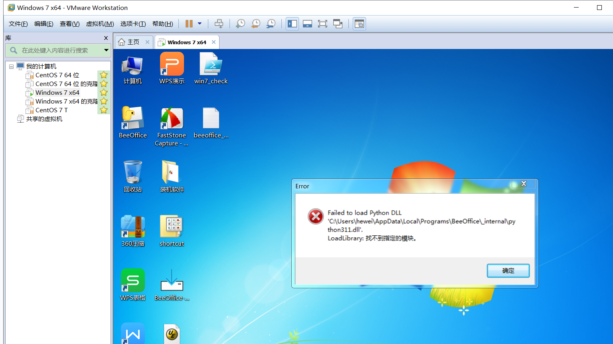

# Windows 7 VM 安装验收记录（2026-11-05）

> 目的：按要求在 Windows 7 VM 上做安装/启动/卸载验收。
> 结论：**安装器壳层通过；BeeOffice 应用在 Windows 7 无法启动，因此不能算“干净机验收通过”。**

## 1. 环境

| 项 | 值 |
|---|---|
| 虚拟机 | `F:\Windows 7 x64\Windows 7 x64.vmx` |
| VMware | Workstation 14.1.3 |
| 快照 | `win7MOWWXS配置完毕`（测试前恢复） |
| 客机系统 | Windows 7 SP1 x64 |
| 登录用户 | `HEWEI-PC\hewei` |
| 主机网络 | `ping 192.168.174.1` 通 |
| 安装器 | `BeeOffice-Setup-v5.4.2.exe` |
| 安装器大小 | 155,770,782 B |
| 安装器 sha256 | `b2e3a800b557cc442ff4979b7d03960040fc6946134b7c37e092eff30f06da9f` |

## 2. 安装结果：通过

通过 VMware Guest Operations 执行静默安装：

```text
BeeOffice-Setup-v5.4.2.exe /VERYSILENT /SUPPRESSMSGBOXES /NORESTART /NOICONS
```

| 检查 | 结果 |
|---|---|
| 安装器退出码 | **0** |
| 安装日志 | `Installation process succeeded` |
| `BeeOffice.exe` 存在 | ✅ |
| 安装目录 | `C:\Users\hewei\AppData\Local\Programs\BeeOffice` |

## 3. 启动结果：失败（Windows 7 不支持）

启动 `BeeOffice.exe` 后出现错误对话框：

```text
Error
Failed to load Python DLL
'C:\Users\hewei\AppData\Local\Programs\BeeOffice\_internal\python311.dll'.
LoadLibrary: 找不到指定的模块。
```



原因：

- BeeOffice v5.4.2 使用 Python 3.11；
- PySide6 / Qt 6 目标平台为 Windows 10/11；
- Windows 7 缺少 Python 3.11 运行所需的系统 API/DLL。

**这不是安装器问题，是 OS 不支持。**

## 4. 卸载结果：通过

执行：

```text
unins000.exe /VERYSILENT /SUPPRESSMSGBOXES /NORESTART
```

| 检查 | 结果 |
|---|---|
| 卸载器退出码 | **0** |
| 卸载日志 | `Uninstallation process succeeded` / `Removed all? Yes` |
| `BeeOffice.exe` | ✅ 已删除 |
| 安装目录 | ✅ 已删除 |

## 5. 最终结论

| 项 | 结果 |
|---|---|
| 安装器在 Win7 安装 | ✅ PASS |
| 安装器在 Win7 卸载 | ✅ PASS |
| BeeOffice 应用在 Win7 启动 | ❌ FAIL |
| 是否需要 Win10/11 VM | ✅ 是 |

**不能把本次记录写成“BeeOffice 干净机验收通过”。**

建议：

1. 短期：Win7 只作为安装器壳层测试；
2. 正式干净机验收必须使用 Windows 10/11 x64 VM；
3. 当前 Win7 VM 可作为“最低不支持平台”的失败证据保留。
