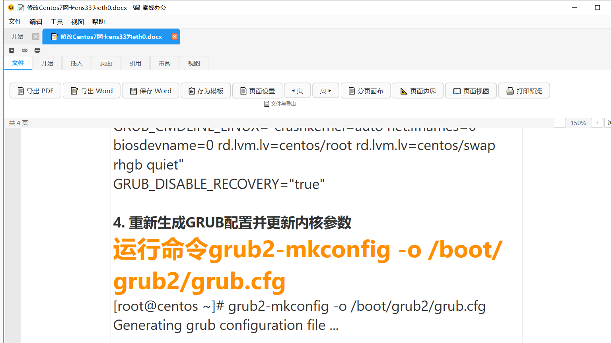

# BeeOffice v5.4.3 本地 Windows 验证（2026-11-09）

> 说明：当前没有 Windows 10/11 干净虚拟机，本记录是**本机 Windows 10 验证**，不是干净机验收。

## 环境

| 项 | 值 |
|---|---|
| 主机系统 | Microsoft Windows 10 专业版 10.0.19041 x64 |
| 包 | BeeOffice-v5.4.3-windows.zip |
| 包 sha256 | `5a465caa7697bb690ce814b85a3d5684ba808f8e25b5b9231a889699983cd034` |
| 安装器 | BeeOffice-Setup-v5.4.3.exe |
| 安装器 sha256 | `5678ca27d6b935da5dde7deeb38e13ed146787b021b8e250b7e8ca8908321d5f` |
| verify_release | ✅ 5/5 |
| 全量测试 | 1029 passed |

## 验证结果

1. 打包版 `BeeOffice.exe` 启动成功；
2. 打开真实 Word 文档：`修改Centos7网卡ens33为eth0.docx`；
3. 文档默认进入分页画布；
4. 页面显示共 4 页，适合宽度 150%；
5. 页边距、页眉页脚区域、分页画布渲染正常；
6. 窗口标题：`修改Centos7网卡ens33为eth0.docx - 🐝 蜜蜂办公`。

截图：

## 未完成

- Windows 10/11 干净 VM 验收：无环境；
- Windows 7 应用启动：不支持（python311.dll 加载失败）；
- 真实多显示器/混合 DPI 验收：仅 1 块屏。

## 结论

本机 Windows 10 上 v5.4.3 可启动并打开真实 Word 文档进入分页画布。  
**不能写成“干净机验收通过”。**
