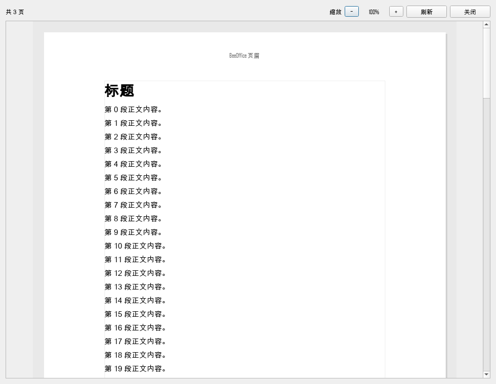

# 纸张页面视图（第二阶段首版，2026-11-05）

## 1. 已实现

- “📖 页面视图”按钮（页面 Ribbon / 快速访问栏）；
- 快捷键 `Ctrl+Alt+P`；
- A4 纸张 + 当前页面设置的页边距；
- 垂直分页滚动，页间灰色间隔；
- 每页底部真实页码；
- 顶部“共 N 页”；
- 对话框内缩放 50%–200%；
- 只读预览，不改变原文档。

截图：

## 2. 实现方式

- `beeoffice/plugins/beewrite_page_view.py`
  - `build_page_document()`：富文本克隆或 Markdown 转 QTextDocument；
  - `PaperPageView`：按 A4/页边距设置 `QTextDocument.setPageSize()`，
    逐页绘制，页边距辅助线、页码、纸张阴影；
  - `PageViewDialog`：滚动区 + 页码 + 缩放 + 刷新/关闭。
- `BeeWriteEditor._open_page_view()` 组装当前内容与页面设置。

## 3. 已验证

- `tests/qt/test_beewrite_nav_zoom.py::test_page_view_dialog`
  - 页数 ≥ 1；
  - “共 N 页”；
  - 缩放 150% 标签正确；
- 人工截图检查：纸张、页边距、正文、页码正常。

## 4. 当前限制

- **只读**：不能在页面视图里直接编辑；
- 页眉页脚、页码域、分栏尚未绘制；
- 分页是 QTextDocument 的打印分页，和 WPS 的 Word 版式不保证逐字一致；
- 页面设置改变后需重新打开或点“刷新”；
- 尚未做 150%/200% DPI 的页面视图截图。

## 5. 下一步

1. 页面视图内“点击定位到编辑区”；
2. 页眉页脚与页码域绘制；
3. 页面设置变更实时刷新；
4. 可编辑的纸张页面视图（长期）。

## 6. 第二轮增强（2026-11-05）

### 已实现

- **页眉/页脚绘制**：读取蜜写的 `_header_text` / `_footer_text`；
- **页码域**：按页码配置绘制“第 X 页 / 共 N 页”等格式，支持起始页；
- **页面设置实时刷新**：页面视图打开时每 700ms 检查页面设置/页眉页脚/页码配置，
  变化后自动重建；
- **点击定位**：点击纸张正文 → 在编辑区定位；Markdown 模式会先切到富文本；
- 新增测试：
  - 页眉/页脚传递；
  - 页面设置变化后刷新；
  - 点击坐标 → 文档位置。

### 限制

- 点击定位在 Markdown 模式下会触发一次模式切换（位置按渲染文档近似）；
- 页眉/页脚目前只绘制单行文本，不解析域；
- 实时刷新只检测设置变化，正文修改仍需点“刷新”；
- 页面视图仍为只读。

### 后续

- 可编辑页面视图；
- 页眉页脚域（页码、日期、标题）；
- 正文修改实时刷新；
- 分节/分栏。
